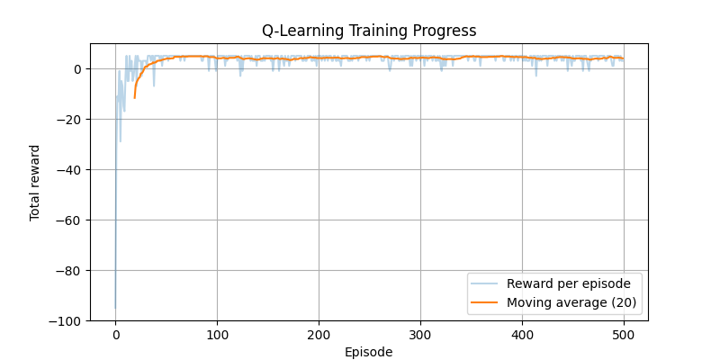

# Grid World Navigation with Q-Learning

A tabular Q-Learning agent that learns to navigate a 4×4 Grid World with walls, reaching the goal in the fewest steps. No neural networks are used, only a Q-table.

## Environment

```
S . . .
. # . .
. . . #
. . . G
```

| Symbol | Meaning | Position (row, col) |
|---|---|---|
| S | Start | (0, 0) |
| G | Goal | (3, 3) |
| # | Wall | (1, 1), (2, 3) |

**Actions:** Up, Down, Left, Right

**Rewards:**

| Event | Reward |
|---|---|
| Reaching the goal | +10 |
| Normal movement | -1 |
| Moving into a wall or outside the grid | -2 (agent stays in place) |

## Hyperparameters

| Parameter | Value | Meaning |
|---|---|---|
| Episodes | 500 | Number of training attempts |
| Max steps per episode | 100 | Safety limit |
| Alpha (α) | 0.1 | Learning rate |
| Gamma (γ) | 0.9 | Discount factor |
| Epsilon (ε) | 0.1 | Chance of exploring a random action |

## How to Run

1. Install the requirements: `pip install numpy matplotlib`
2. Open `grid_world_q_learning.ipynb` in Jupyter or Google Colab.
3. Run all cells from top to bottom.

## Results

### Final learned path

```
S . . .
* # . .
* * * #
. . * G

Path: [(0, 0), (1, 0), (2, 0), (2, 1), (2, 2), (3, 2), (3, 3)]
Steps taken: 6
```

The trained agent reaches the goal in 6 steps, which is the shortest possible path. It avoids both walls.

### Learned Q-table

Columns: Up, Down, Left, Right

```
(0, 0) [-0.82  1.81 -0.88 -1.61]
(0, 1) [-1.51 -1.54 -1.55  0.27]
(0, 2) [-0.98  3.13 -0.88 -0.85]
(0, 3) [-0.79 -0.75 -0.72 -1.11]
(1, 0) [-0.1   3.12 -0.44  0.07]
(1, 1) WALL
(1, 2) [-0.44  6.01  0.09 -0.59]
(1, 3) [-0.69 -0.78 -0.66 -0.78]
(2, 0) [0.77 0.58 1.58 4.58]
(2, 1) [2.42 2.85 1.92 6.2 ]
(2, 2) [2.81 8.   2.71 3.5 ]
(2, 3) WALL
(3, 0) [ 0.26 -0.38 -0.39  3.86]
(3, 1) [ 0.28  0.29 -0.21  7.91]
(3, 2) [ 3.59  5.16  4.8  10.  ]
(3, 3) [0. 0. 0. 0.]
```

### Training reward graph



The total reward per episode starts very low (around -95), because the agent wanders and hits walls. It rises quickly and levels off near +5 after about 50 episodes. +5 is the best possible score: five normal moves (-5) plus the goal (+10). The small dips later are caused by the 10% random exploration.

## Explanation

**State:** The agent's current position in the grid, written as (row, col). There are 16 states.

**Action:** A move the agent can make: Up, Down, Left or Right.

**Reward:** The score the agent receives after each action: +10 for the goal, -1 for a normal move, -2 for hitting a wall or the edge. The -1 on every move teaches the agent that shorter paths are better.

**Q-value:** A number that estimates how good it is to take a specific action in a specific state. All Q-values are stored in the Q-table (4 rows × 4 columns × 4 actions).

**Learning:** After every move, the agent updates one Q-value using:

```
Q(state, action) = Q(state, action) + α × (reward + γ × max Q(next state) - Q(state, action))
```

The agent moves its old estimate a little toward the target, which is the reward it just got plus the best value it expects from the next state. The values near the goal are learned first. Over many episodes, this information spreads backward to the start, which is why the Q-values in the table grow as the path gets closer to the goal (1.81 → 3.12 → 4.58 → 6.2 → 8.0 → 10.0).

**Policy:** The agent's final strategy: in each state, choose the action with the highest Q-value. Following this policy from the start gives the 6-step path shown above.

### Exploration vs. exploitation

The agent uses an ε-greedy strategy. With probability ε (0.1) it explores by trying a random action. Otherwise it exploits by choosing the best known action. Exploration lets the agent discover better routes, and exploitation lets it use what it has already learned.

### How the agent learned

1. At first, the Q-table was all zeros, so the agent knew nothing and moved mostly at random.
2. By trying actions and receiving rewards, it updated the Q-table after every step.
3. Reaching the goal (+10) gave high values to the last moves, and those values spread backward through the grid over many episodes.
4. Bumping into walls (-2) and wasting steps (-1) lowered the values of bad actions.
5. After 500 episodes, the best action in each cell pointed along the shortest path to the goal.

## Files

- `grid_world_q_learning.ipynb`: Python source code
- `README.md`: this file
- `reward_graph.png`: training reward graph
